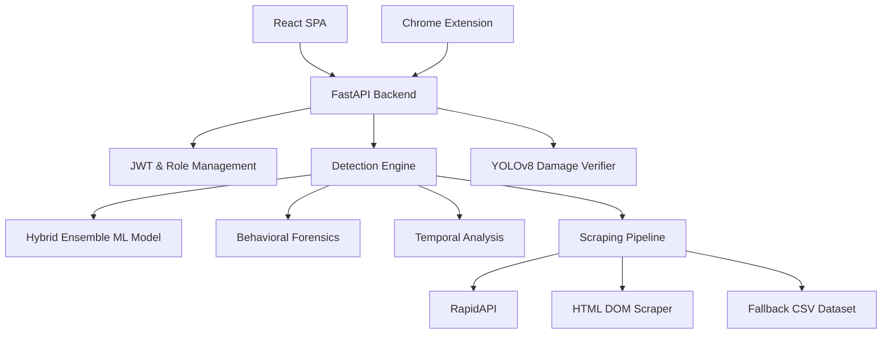
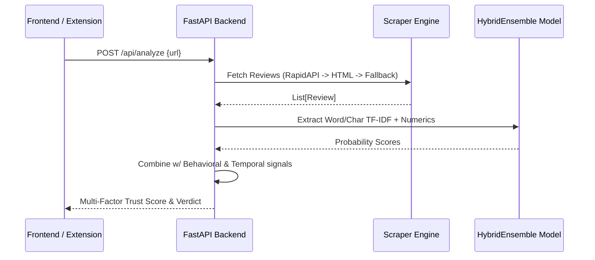

# TrustGuard AI

Fake Review Intelligence Platform and E-commerce Defense Ecosystem.

## Overview

## Overview

TrustGuard AI is a full-stack research prototype designed to analyze fake reviews, opinion manipulation, and related e-commerce fraud risks. It combines a hybrid NLP ensemble, behavioral and temporal heuristics, URL security screening, and a YOLOv8-based garment damage-claim verifier into a unified platform.

The system provides a React dashboard, FastAPI backend, Chrome extension, and role-based workflow for consumers, administrators, analysts, and platform owners.

TrustGuard AI generates a multi-factor Trust Score (0–100), risk indicators, and supporting evidence. The NLP classifier is evaluated on a held-out review dataset, while behavioral, temporal, and fused product-level scores remain heuristic and have not been independently validated against product-level ground truth.

Live review acquisition is implemented for Amazon and Flipkart. Other supported marketplace URLs may use a local dataset fallback for demonstration. The damage-claim verifier is intended as an advisory triage tool and does not make automatic refund decisions.

The platform is a research prototype and should not be considered production-ready.


## Features

- **TrustBuy Analyzer**: Consumer-facing portal to paste any product URL or text for a comprehensive Multi-Factor Trust Score (0–100%) and Verdict Cards.
- **Mission Control**: Admin command center featuring a real-time WebSocket intelligence feed, ML performance metrics, and a one-click retraining pipeline.
- **Network Forensics**: Visual force-directed bipartite graph (React Force Graph 2D) uncovering review syndicates and coordinated botnets.
- **Reputation Management**: Strategic brand health tracking, 12-month trust trends, sentiment distribution, and linguistic mimicry detection.
- **Damage Claim Verifier**: YOLOv8 image-based classification for insurance/refund fraud (classifies images as `fake_damage` or `real_damage`).
- **Analyst Panel**: Dedicated workspace for data analysts to process deep-analysis requests and submit structured reports.
- **Chrome Extension**: Manifest V3 extension providing live risk badges and bypassing anti-bot measures via direct DOM injection scanning.
- **URL Security Engine**: 9-layer heuristic URL threat classifier (phishing, typosquatting, risky TLDs).

## Architecture

The system operates on a decoupled client-server architecture with multi-source data ingestion and a robust machine learning pipeline.



## Tech Stack

- **Python**
- **FastAPI**
- **React**
- **Vite**
- **scikit-learn**
- **Ultralytics YOLOv8**
- **SQLite**
- **Tailwind CSS**
- **pandas**
- **numpy**
- **TextBlob**
- **VADER**
- **BeautifulSoup4**
- **cloudscraper**
- **ReportLab**
- **React Force Graph 2D**

## Installation

### Prerequisites
- Python 3.9+
- Node.js 18+

### Backend Setup
1. Clone the repository and navigate to the `backend` directory.
2. Install Python dependencies:
   ```bash
   pip install -r requirements.txt
   ```
3. Download required NLTK corpora:
   ```bash
   python -c "import nltk; nltk.download('stopwords'); nltk.download('wordnet')"
   ```
4. Train the ML model (required before first run):
   ```bash
   python -m backend.train_model
   ```

### Frontend Setup
1. Navigate to the `frontend` directory.
2. Install Node dependencies:
   ```bash
   npm install
   ```

### Chrome Extension Setup
1. Open Chrome and navigate to `chrome://extensions/`.
2. Enable **Developer Mode**.
3. Click **Load Unpacked** and select the `extension/` folder.

## Configuration

Required environment variables should be placed in `backend/.env`:

- `RAPIDAPI_KEY` (Optional): API key for live Amazon/Flipkart review fetching via RapidAPI. If omitted, the system falls back to direct HTML scraping and dataset fallbacks.
- `RAINFOREST_API_KEY` (Optional): Alternative Amazon product data API key.

## Running

### Development

We provide unified startup scripts in the root directory.

**Windows:**
```bat
start.bat
```
**Linux / macOS:**
```bash
chmod +x start.sh
./start.sh
```

Alternatively, start them separately:
- **Backend:** `uvicorn backend.api.main:app --host 0.0.0.0 --port 8001 --reload`
- **Frontend:** `npm run dev` (runs on http://localhost:5173)

### Training

To manually retrain the hybrid ensemble NLP model:
```bash
cd backend
python -m backend.train_model
```
To train the YOLOv8 Damage Detector:
```bash
python -m backend.damage_detector.train
```

## API

### Core Endpoints

| Method | Path | Purpose | Authentication |
|---|---|---|---|
| `POST` | `/api/auth/login` | Authenticate and retrieve JWT token | Public |
| `POST` | `/api/analyze` | Full product analysis via URL or text | Protected (User/Admin) |
| `POST` | `/analyze-batch` | Bulk review analysis | Protected |
| `WS`   | `/ws/live-analysis` | WebSocket stream for live bot interceptions | Protected (Admin) |
| `POST` | `/api/damage-detector/predict` | Classify image for damage fraud | Protected |
| `POST` | `/api/check-url` | Run 9-layer heuristic URL security check | Public |

## Folder Structure

```text
TrustGuard-AI/
├── backend/
│   ├── api/                 # FastAPI routes and schemas
│   ├── auth/                # JWT authentication and SQLite DB setup
│   ├── damage_detector/     # YOLOv8 inference, training, and models
│   ├── data/                # Fallback datasets and training data
│   ├── engine/              # Core NLP, scraping, and detection logic
│   └── models/              # Serialized scikit-learn models (.joblib)
├── dataset/                 # Raw YOLOv8 images and labels (train/valid/test)
├── extension/               # Chrome Manifest V3 extension source code
└── frontend/
    └── src/
        ├── components/      # Reusable React components (Charts, Tables)
        └── pages/           # Main route views (TrustBuy, MissionControl, etc.)
```

## Workflow

1. **User Input:** A user or the Chrome Extension submits a product URL or raw text to the FastAPI backend.
2. **Data Acquisition:** The scraper pipeline attempts RapidAPI; falls back to `cloudscraper`; and finally falls back to a deterministic subset of a static dataset if blocked.
3. **Detection Engine:** The text data passes through a Hybrid Ensemble model (Logistic Regression + SGD + Naive Bayes), backed by temporal review-burst analysis and behavioral duplication checks.
4. **Result Delivery:** A structured JSON response containing the Multi-Factor Trust Score, Risk Level, and linguistic evidence is returned to the frontend.
5. **Admin Monitoring:** Admins monitor real-time WebSocket feeds of processed reviews in the Mission Control dashboard.

## Data Flow



## Models

### 1. NLP Trust Classifier
- **Datasets:** 46,548 samples (21,423 fake, 25,125 real) from `fake_reviews_dataset.csv` and `final_labeled_fake_reviews.csv`.
- **Preprocessing:** Regex cleanup, negation-preserving stopword removal, WordNet lemmatization.
- **Features:** Word TF-IDF (1-3 grams), Char TF-IDF (2-4 grams), 8 handcrafted numeric metrics.
- **Architecture:** Soft Voting Ensemble (LR weight 4, SGD weight 2, NB weight 1).
- **Evaluation:** 84.09% Accuracy, 91.11% ROC-AUC.
- **Checkpoints:** Stored as `backend/models/lr_pipeline.joblib`.

### 2. Damage Claim Verifier
- **Architecture:** Ultralytics YOLOv8.
- **Classes:** `fake_damage` (0), `real_damage` (1).
- **Inference:** Confidence threshold of 0.25; returns bounding boxes.
- **Checkpoints:** `backend/damage_detector/saved_models/damage_detector_best.pt`.

## Troubleshooting

- **Dataset Not Found during Training:** Ensure you have placed `fake_reviews_dataset.csv` inside `backend/data/`.
- **Model Load Errors (503):** The API requires models to exist at startup. You MUST run `python -m backend.train_model` before starting the backend.
- **RapidAPI 403 Forbidden:** Ensure you are subscribed to the "Real-Time Amazon Data" API on RapidAPI and your key is properly set in `backend/.env`.
- **No Reviews Scraped:** If no API key is set, Amazon may block the HTML scraper. The system will safely fallback to dataset sampling, meaning the UI will still function for demonstration purposes.

## Contributing

1. Fork the repository.
2. Create a feature branch (`git checkout -b feature/NewFeature`).
3. Commit your changes (`git commit -m 'Add NewFeature'`).
4. Push to the branch (`git push origin feature/NewFeature`).
5. Open a Pull Request.

## License

Research Project — Internal Use Only.
Developed for Final Year Project submission, 2026.
