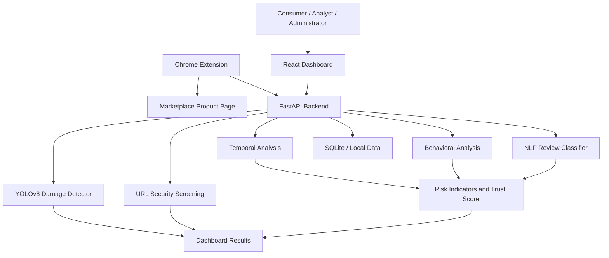

# TrustGuard AI

### AI-Powered Fake Review, Opinion Manipulation and E-Commerce Trust Analysis

TrustGuard AI is a full-stack research prototype that analyzes fake reviews, suspicious user behavior, opinion manipulation, and e-commerce damage-claim risks. It combines machine-learning-based review classification with behavioral and temporal indicators to provide explainable risk insights.

> **Research Disclaimer:** TrustGuard AI is a research prototype, not a production-ready fraud detection or refund-decision system. Its Trust Score is an evidence-based heuristic indicator, not a calibrated probability of fraud.

---

## Table of Contents

- [Overview](#overview)
- [Key Features](#key-features)
- [System Architecture](#system-architecture)
- [Technology Stack](#technology-stack)
- [Machine Learning Models](#machine-learning-models)
- [Evaluation Results](#evaluation-results)
- [Trust Score Calculation](#trust-score-calculation)
- [Chrome Extension](#chrome-extension)
- [API Endpoints](#api-endpoints)
- [Installation and Setup](#installation-and-setup)
- [Project Structure](#project-structure)
- [Limitations](#limitations)
- [Security Considerations](#security-considerations)
- [Future Scope](#future-scope)
- [License](#license)

---

## Overview

Online marketplaces rely heavily on customer reviews and ratings. However, fake reviews, coordinated manipulation, bot-generated comments, and misleading product information can affect consumer trust and purchasing decisions.

TrustGuard AI aims to help users identify potentially suspicious reviews and assess product credibility through multiple signals.

The platform includes:

- A React-based dashboard for review and product analysis.
- A FastAPI backend for analysis and API services.
- A hybrid NLP ensemble for review classification.
- Behavioral and temporal risk indicators.
- URL security screening.
- A YOLOv8-based garment damage-claim verification module.
- A Chrome extension for extracting reviews from supported marketplace pages.
- Role-based workflows for consumers, analysts, administrators, and platform owners.

Live review extraction is implemented for **Amazon and Flipkart**. Other marketplace URLs may use local dataset fallback for demonstration and analysis.

---

## Key Features

### 1. Fake Review Detection

Analyzes review text to classify potentially fake or genuine reviews using a hybrid NLP ensemble.

Features include:

- TF-IDF-based text representation.
- Word-level and character-level features.
- Handcrafted linguistic features.
- Ensemble classification.
- Review-level risk indicators.

### 2. Behavioral Analysis

Analyzes review-related behavioral indicators, including:

- Duplicate or highly similar reviews.
- Suspicious review patterns.
- Reviewer activity indicators.
- Potentially unusual author behavior.

Behavioral signals are heuristic indicators and should not be interpreted as confirmed evidence of fraud.

### 3. Temporal Analysis

Identifies potentially suspicious review activity patterns, such as:

- Sudden increases in review activity.
- Unusual review bursts.
- Temporal patterns that may warrant further investigation.

Temporal signals are heuristic and require independent validation against labeled product-level data.

### 4. Product Trust Analysis

Combines review classification and additional risk indicators to provide a product-level Trust Score and supporting evidence.

The score is intended to support investigation and decision-making. It is not a verified fraud probability.

### 5. URL Security Screening

Screens submitted URLs using multiple security checks to identify potentially unsafe or suspicious links.

The result is a screening indicator and should not be treated as a guarantee that a URL is safe.

### 6. Damage-Claim Verification

Uses a YOLOv8-based model to analyze uploaded garment images for damage-related indicators.

The module is designed for **advisory triage only**. It must not automatically approve or reject refunds.

### 7. Chrome Extension

The extension extracts review information from supported Amazon and Flipkart product pages and displays an in-page risk indicator.

It is intended to assist users while browsing supported marketplace pages.

### 8. Dashboard and Role-Based Workflows

The dashboard provides analysis views and workflows for different user roles:

- Consumer
- Data Analyst
- System Administrator
- Platform Owner

Role-based navigation is implemented in the frontend. See [Security Considerations](#security-considerations) for current backend authorization limitations.

---

## System Architecture



The system separates the user interface, backend APIs, analysis modules, and data storage.

---

## Technology Stack

| Component | Technology |
|---|---|
| Frontend | React 18, Vite |
| Styling | Tailwind CSS |
| UI Animation | Framer Motion |
| Backend | Python, FastAPI |
| NLP | Scikit-learn, TF-IDF |
| NLP Models | Logistic Regression, SGD Classifier, Multinomial Naive Bayes |
| Computer Vision | YOLOv8 |
| Database | SQLite |
| Browser Extension | Chrome Extension, Manifest V3 |
| API Communication | REST API |

---

## Machine Learning Models

### NLP Review Classification

The review classifier uses a hybrid feature representation consisting of:

- **15,000 word-level TF-IDF features**
- **8,000 character-level TF-IDF features**
- **8 handcrafted features**

This produces a combined feature representation of 23,008 features.

The ensemble includes:

| Model | Description |
|---|---|
| Logistic Regression | Linear classification model |
| SGD Classifier | Stochastic gradient-based classifier |
| Multinomial Naive Bayes | Probabilistic text classifier |

The ensemble uses a weighted voting configuration:

- Logistic Regression: 4
- SGD Classifier: 2
- Multinomial Naive Bayes: 1

These are implementation-level ensemble weights, not learned or calibrated fraud probabilities.

### Damage Detection Model

The damage-claim module uses a YOLOv8-based object detection model to analyze garment images.

The model is intended to identify damage-related visual indicators. Its performance is limited and should be considered experimental.

---

## Evaluation Results

### NLP Review Classification

The NLP classifier was evaluated on a held-out review dataset.

| Metric | Result |
|---|---:|
| Accuracy | 84.09% |
| Precision | 84.82% |
| Recall | 79.70% |
| F1-Score | 82.18% |
| ROC-AUC | 91.11% |
| PR-AUC | 91.78% |

**Dataset:** 46,548 review samples  
**Split:** 80% training and 20% testing

These results describe the review-text classification model only. They do not represent the overall performance of the complete TrustGuard AI platform.

### Damage Detection Evaluation

| Metric | Result |
|---|---:|
| mAP@0.5 | 22.07% |
| Fake Damage Recall | 45.16% |
| Real Damage Recall | 6.25% |

The damage detector has limited performance, particularly for real-damage detection. It should be used only for experimental analysis and advisory triage.

The results should not be used as the sole basis for refund approval, refund rejection, or other financial decisions.

---

## Trust Score Calculation

TrustGuard AI combines several signals to generate a product-level Trust Score.

The implemented design uses the following weights:

| Signal | Weight |
|---|---:|
| NLP Review Analysis | 40% |
| Behavioral Analysis | 30% |
| Temporal Analysis | 30% |

Conceptually:

```text
Trust Score =
    NLP Signal       × 0.40
  + Behavioral Signal × 0.30
  + Temporal Signal   × 0.30
```

The score is intended to summarize risk indicators for review and investigation.

**Important:** The weighting configuration is heuristic. Behavioral, temporal, and fused product-level scores have not been independently validated against labeled product-level ground truth. Therefore, the score must not be interpreted as a statistically calibrated probability of fraud.

---

## Chrome Extension

TrustGuard AI includes a Chrome extension built using Manifest V3.

### Intended Workflow

1. Open a supported Amazon or Flipkart product page.
2. The extension extracts review information from the page DOM.
3. Extracted reviews are submitted for analysis.
4. The backend returns analysis results.
5. The extension displays an in-page risk indicator.

The extension supports review extraction from Amazon and Flipkart. Marketplace DOM structures may change, which can affect extraction reliability.

---

## API Endpoints

The backend exposes analysis endpoints including:

| Endpoint | Purpose |
|---|---|
| `/api/review/analyze` | Review analysis |
| `/api/bot/analyze` | Bot or suspicious behavior analysis |
| `/api/image/analyze` | Image-related analysis |

The exact request and response schemas should be checked in the backend implementation.

---

## Installation and Setup

### Prerequisites

Install the following before running the project:

- Python 3.10 or compatible version required by the project dependencies
- Node.js and npm
- Git
- Google Chrome, if using the extension

### 1. Clone the Repository

```bash
git clone <YOUR_GITHUB_REPOSITORY_URL>
cd TrustGuard-AI
```

Replace `<YOUR_GITHUB_REPOSITORY_URL>` with the repository URL.

### 2. Set Up the Backend

```bash
cd backend
python -m venv venv
```

Activate the virtual environment.

**Windows:**

```bash
venv\Scripts\activate
```

**Linux / macOS:**

```bash
source venv/bin/activate
```

Install the backend dependencies:

```bash
pip install -r requirements.txt
```

Create the required environment configuration using the project's environment template, if available.

Start the FastAPI server using the backend's actual application entry point. For example, if the application is defined in `main.py` as `app`:

```bash
uvicorn main:app --reload
```

If the entry-point file or application variable has a different name, use the corresponding module path.

### 3. Set Up the Frontend

Open a new terminal:

```bash
cd frontend
npm install
```

Start the development server:

```bash
npm run dev
```

Open the local URL printed by Vite in the terminal.

### 4. Load the Chrome Extension

1. Open Chrome.
2. Navigate to `chrome://extensions`.
3. Enable **Developer mode**.
4. Click **Load unpacked**.
5. Select the Chrome extension directory from the repository.
6. Open a supported Amazon or Flipkart product page to test the extension.

---

## Project Structure

The project is organized into frontend, backend, extension, and supporting resources.

```text
TrustGuard-AI/
│
├── backend/
│   ├── data/
│   ├── logs/
│   ├── models/
│   ├── requirements.txt
│   └── ...
│
├── frontend/
│   ├── public/
│   ├── src/
│   ├── package.json
│   └── ...
│
├── extension/
│   ├── manifest.json
│   └── ...
│
├── README.md
└── ...
```

Some directories and files may vary depending on the current repository version.

---

## Limitations

TrustGuard AI is an academic research prototype and has several limitations:

- Live review extraction is implemented for Amazon and Flipkart; other marketplaces may use local dataset fallback.
- Dataset fallback results should not be interpreted as live marketplace analysis.
- Generated or fallback review metadata may be illustrative.
- Behavioral and temporal indicators are heuristic.
- Product-level Trust Scores have not been validated against independent product-level ground truth.
- Some dashboard statistics and reputation or price-history visualizations may use simulated or placeholder data.
- The damage detector has limited evaluation performance, particularly for real-damage detection.
- Image-based damage detection may be affected by image quality, dataset bias, and differences between training and real-world images.
- The system does not establish that a reviewer, review, product, or seller is fraudulent.
- Marketplace website changes may break review extraction.
- The platform has not undergone a complete production security audit.

The system should be used for research, demonstration, and decision support—not as an autonomous fraud, refund, or reputation enforcement system.

---

## Security Considerations

Before deploying TrustGuard AI beyond a local research environment:

- Replace default or fallback JWT secrets with strong environment-specific secrets.
- Remove or disable seeded demonstration accounts.
- Enforce authorization checks on every protected backend endpoint.
- Do not rely only on frontend role-based navigation for access control.
- Review file-upload validation and size restrictions.
- Avoid committing `.env` files, credentials, private datasets, or model artifacts.
- Configure CORS and network access appropriately.
- Use HTTPS for network-accessible deployments.
- Perform a security review before exposing the backend publicly.

At the current implementation stage, server-side role and token checks are not uniformly enforced across all protected endpoints. The application should not be considered secure for public deployment without additional hardening.

---

## Future Scope

Potential future improvements include:

- Improving damage detection with larger and more diverse datasets.
- Evaluating the complete system on independently labeled product-level data.
- Calibrating and validating Trust Score outputs.
- Improving marketplace review extraction reliability.
- Expanding support for additional marketplaces.
- Strengthening server-side authentication and authorization.
- Replacing simulated dashboard statistics with validated real data.
- Improving behavioral and temporal fraud detection.
- Conducting broader security and performance testing.

---

## License

This project is an academic research project.

If the repository is intended for restricted academic or internal use, specify the applicable usage terms here. Do not describe it as open-source unless an appropriate open-source license is added.

---

## Acknowledgment

TrustGuard AI was developed as an academic project focused on fake review detection, opinion manipulation analysis, and e-commerce trust assessment.

**TrustGuard AI — Towards More Transparent and Trustworthy E-Commerce.**
