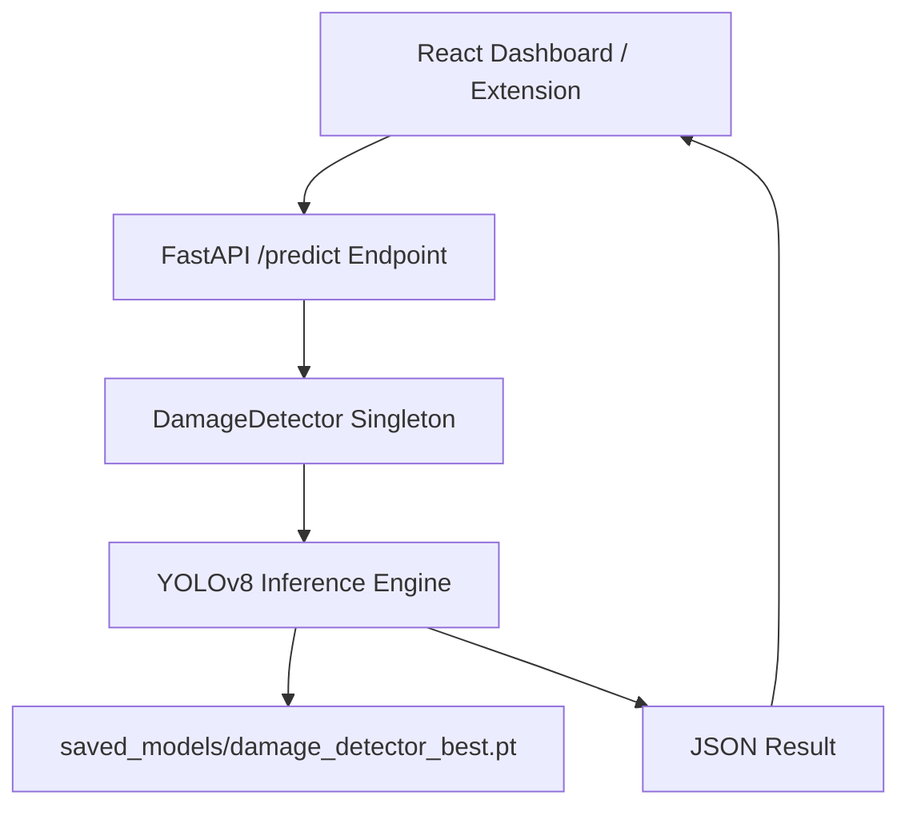
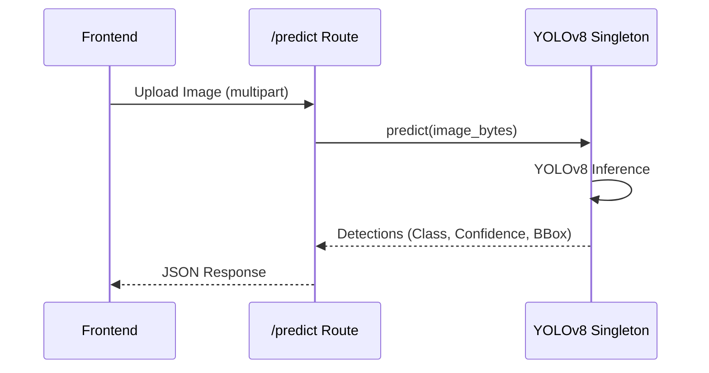

# Damage Claim Verifier (YOLOv8 Module)

Fake Review Intelligence Platform — Computer Vision Module.

## Overview

The Damage Claim Verifier is a dedicated backend sub-module powered by a custom-trained YOLOv8 object detection model. It classifies product damage images uploaded as part of return/refund claims or reviews to detect digitally fabricated or manipulated images, helping prevent insurance and return fraud.

## Features

- **Fraud Detection**: Classifies images into `fake_damage` (digitally manipulated) or `real_damage` (authentic).
- **REST API Integration**: Seamlessly connects with the FastAPI backend for real-time inference.
- **Confidence Scoring**: Returns detailed bounding boxes, class summaries, and per-detection confidence scores.
- **Automated Serving**: Automatically serves the best trained checkpoint on backend startup.

## Architecture

The module operates as an integrated service within the FastAPI backend. It utilizes a Singleton pattern to load the YOLOv8 model into memory once, ensuring fast inference without reload overhead per request.



## Tech Stack

- **Python**
- **Ultralytics YOLOv8**
- **OpenCV**
- **FastAPI**

## Installation

This module is part of the TrustGuard-AI backend. Its dependencies are included in the main `backend/requirements.txt`.

Ensure you have installed:
```bash
pip install ultralytics>=8.0.0 opencv-python>=4.8.0
```

## Configuration

No environment variables are required. 
The YOLO label format requires normalized values [0, 1] for bounding boxes:
`<class_id> <cx> <cy> <width> <height>`

Class IDs:
- `0` → `fake_damage`
- `1` → `real_damage`

## Running

### Development / Inference
The inference engine starts automatically when you run the main backend:
```bash
uvicorn backend.api.main:app --host 0.0.0.0 --port 8001 --reload
```

### Training
To train the YOLO model on a custom dataset, run:
```bash
# Default: yolov8n (nano), 50 epochs, 640px
python -m backend.damage_detector.train

# Custom options:
python -m backend.damage_detector.train --base-model yolov8s.pt --epochs 100 --imgsz 640
```

## API

| Method | Path | Purpose | Request Body | Response |
|---|---|---|---|---|
| `POST` | `/api/damage-detector/predict` | Classify a damage claim image | `multipart/form-data` (file) | JSON (Prediction, BBoxes, Confidence) |
| `GET` | `/api/damage-detector/status` | Check if model is loaded | None | JSON (Model Status) |

## Folder Structure

```text
damage_detector/
├── inference.py         # YOLOv8 singleton DamageDetector class
├── routes.py            # FastAPI endpoints for inference and status
├── train.py             # YOLOv8 training script
└── saved_models/        # Checkpoint directory
    └── damage_detector_best.pt  # Canonical best model weights
```

## Workflow

1. **Training (Optional)**: `train.py` trains YOLOv8 on `dataset/` and copies `best.pt` to `saved_models/`.
2. **Startup**: `inference.py` initializes a Singleton, loading `damage_detector_best.pt` into memory.
3. **Inference**: A user uploads an image. It is passed via `/predict` to the YOLO engine.
4. **Classification**: Bounding boxes and confidence scores are calculated. If the maximum confidence is above 0.25, the highest-confidence class is returned. Otherwise, it returns `normal`.

## Data Flow



## Models

- **Architecture:** Ultralytics YOLOv8 (Supports `nano`, `small`, `medium`).
- **Input Size:** 640x640.
- **Classes:** 2 (`fake_damage`, `real_damage`).
- **Threshold:** 0.25 minimum confidence.
- **Checkpoints:** Output weights are copied to `backend/damage_detector/saved_models/damage_detector_best.pt`.

## Deployment

Deploy alongside the main FastAPI application. Since the model file (`.pt`) is loaded into memory, ensure the deployment environment has sufficient RAM (approx 300MB extra depending on the YOLO model size chosen).

## Troubleshooting

- **Model Not Found (HTTP 503)**: If the backend logs `Model NOT loaded — Model file not found`, you must run the training script or place a valid YOLOv8 `.pt` file in `backend/damage_detector/saved_models/damage_detector_best.pt`.
- **High Memory Usage**: If using `yolov8m.pt`, VRAM/RAM usage will spike. Fall back to `yolov8n.pt` for constrained environments.

## License

Research Project — Internal Use Only.
Developed for Final Year Project submission, 2026.
