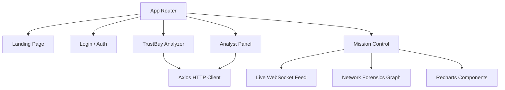
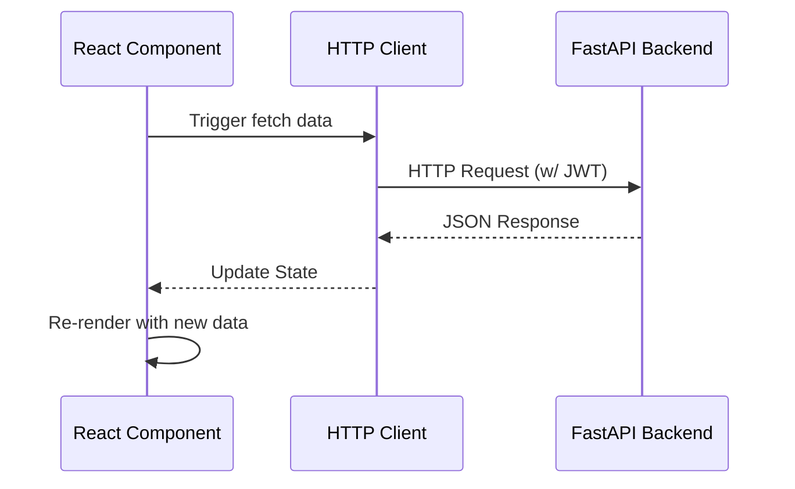

# TrustGuard AI — Frontend Application

Fake Review Intelligence Platform — Client Module.

## Overview

This is the React-based Single Page Application (SPA) for the TrustGuard AI platform. It serves as the primary interface for all user roles, providing the TrustBuy Analyzer for consumers, the Mission Control dashboard for administrators, and the Analyst Panel for data analysts. The frontend delivers real-time intelligence, interactive data visualization, and network forensics to expose opinion manipulation on e-commerce platforms.

## Features

- **TrustBuy Analyzer (`/trustbuy`)**: Consumer interface to input product URLs or reviews and receive a Multi-Factor Trust Score, Risk Classification, and verdict cards.
- **Mission Control (`/`)**: Administrative dashboard featuring a real-time WebSocket intelligence feed, ML performance metrics, and a one-click retraining pipeline.
- **Network Forensics (`/`)**: Visual force-directed bipartite graph (powered by `react-force-graph-2d`) that uncovers review syndicates and coordinated botnets.
- **Analyst Panel (`/analyst`)**: Dedicated workspace for data analysts to process deep-analysis requests and submit structured reports.
- **Damage Claim Verifier (`/damage`)**: Interface to upload images and view YOLOv8 bounding boxes for fraud detection.
- **Role-Based Routing**: Secure routing for `user`, `analyst`, `admin`, and `owner` roles.

## Architecture

The frontend is built as a single-page application using React 18 and Vite. It utilizes functional components and React Hooks for state management, with React Router handling navigation.



## Tech Stack

- **React** (v18.3.1)
- **Vite** (v5.4.10)
- **Tailwind CSS** (v4)
- **React Router**
- **Recharts** (Data Visualization)
- **React Force Graph 2D** (Network Forensics)
- **Framer Motion** (Animations)
- **Three.js / React Three Fiber** (3D Visualizations)
- **Lucide React** (Icons)
- **Axios** (HTTP Client)

## Installation

Ensure you have Node.js 18+ installed.

1. Navigate to the `frontend` directory.
2. Install dependencies:
   ```bash
   npm install
   ```

## Configuration

The frontend currently expects the FastAPI backend to be running on `http://localhost:8001`. No complex `.env` configuration is required for local development.

## Running

### Development
Start the Vite development server with Hot Module Replacement (HMR):
```bash
npm run dev
```
The application will be available at `http://localhost:5173`.

### Production Build
To create a production-ready bundle:
```bash
npm run build
```
The optimized files will be output to the `dist/` directory.

### Linting
```bash
npm run lint
```

## API

The frontend acts as a consumer to the FastAPI backend. It utilizes Axios for REST calls and native WebSockets for real-time data.

**Primary Integrations:**
- `POST /api/auth/login`: Authentication
- `POST /api/analyze`: Trust analysis
- `WS /ws/live-analysis`: Real-time bot interceptions
- `POST /api/damage-detector/predict`: Image upload

## Folder Structure

```text
frontend/
├── package.json
├── vite.config.js
├── tailwind.config.js
├── src/
│   ├── main.jsx                 # Application entry point
│   ├── App.jsx                  # React Router configuration
│   ├── index.css                # Global styles and Tailwind imports
│   ├── components/              # Reusable UI components
│   │   ├── PulseMonitor.jsx
│   │   ├── SentimentPanel.jsx
│   │   ├── FlaggedReviewsTable.jsx
│   │   ├── SystemReputationManagement.jsx
│   │   └── SystemOpinionManipulation.jsx
│   └── pages/                   # Route-level views
│       ├── Landing.jsx
│       ├── Login.jsx
│       ├── TrustBuyAnalyzer.jsx
│       ├── MissionControl.jsx
│       ├── AnalystPanel.jsx
│       ├── BatchAnalysis.jsx
│       └── DamageClaimVerifier.jsx
```

## Workflow

1. **Authentication**: Users log in via `Login.jsx`, receiving a JWT and a role. React Router redirects them to their designated dashboard.
2. **Analysis Request**: In `TrustBuyAnalyzer.jsx`, the user submits a URL. Axios POSTs this to the backend. The component displays loading states using Framer Motion.
3. **Data Visualization**: Upon receiving JSON data, components like `SystemReputationManagement` render Recharts graphs, and `Network Forensics` renders a force-directed graph.
4. **Real-time Monitoring**: `MissionControl.jsx` opens a WebSocket connection to the backend, appending new bot interceptions to its local state and updating the UI instantly.

## Data Flow



## Deployment

To deploy, build the application using `npm run build`. The resulting `dist/` directory can be hosted on any static file server (e.g., Nginx, Vercel, Netlify, AWS S3). If using client-side routing, ensure your server is configured to rewrite all unknown requests to `index.html`.

## Troubleshooting

- **Connection Refused (Network Error)**: Ensure the FastAPI backend is running on `http://localhost:8001`.
- **CORS Issues**: Ensure the FastAPI backend has CORS middleware configured to accept requests from `http://localhost:5173`.
- **Node-GYP Errors on Install**: Ensure you have Python installed and build tools available on your system, as some UI libraries may require native compilation.

## License

Research Project — Internal Use Only.
Developed for Final Year Project submission, 2026.
